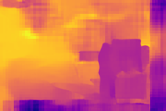

# RAFT-Stereo 示例

## 简介

RAFT-Stereo 是一个基于深度学习的立体匹配（Stereo Matching）模型，用于从一对左右目图像中估计视差图（Disparity Map）,其源码路径为https://github.com/princeton-vl/RAFT-Stereo.git。本示例（基于其开源模型main分支，commit ID:6068c1a26f84f8132de10f60b2bc0ce61568e085）提供了从 PyTorch 模型导出、ONNX 验证到 RKNN 转换的完整流程，以及 C++ 推理部署代码。

## 目录结构

```
RAFT-Stereo/
├── model/
│   ├── setup.sh                                    # 一键模型导出与转换脚本
│   ├── 0001-ENH-Modify-model-to-optimize-performance-in-rknn.patch  # RKNN 性能优化补丁
│   ├── xt_left.jpg                                 # 测试用左目图像
│   └── xt_right.jpg                                # 测试用右目图像
├── python/
│   ├── convert2onnx_fp.py                          # PyTorch → ONNX 转换脚本
│   ├── verify_onnx.py                              # ONNX 模型精度验证脚本
│   └── convert2rknn.py                             # ONNX → RKNN 转换脚本
└── cpp/
    ├── CMakeLists.txt                               # C++ 编译配置
    ├── main.cc                                      # 主程序入口
    ├── raft_stereo.h                                # 推理接口头文件
    ├── raft_stereo.cc                               # 推理接口实现
    └── plasma_lut.h                                 # 视差图可视化颜色查找表
```

---

## 一、setup.sh 使用说明

`setup.sh` 是模型导出与转换的一站式脚本，位于 `model/` 目录下。它封装了从源码获取、ONNX 导出、精度验证到 RKNN 转换的完整流水线。

### 1.1 基本用法

```bash
cd model
bash setup.sh <command> [options]
```

### 1.2 命令说明

| 命令 | 说明 |
|------|------|
| `get_source` | 克隆 RAFT-Stereo 官方仓库，下载预训练模型，并应用 RKNN 优化补丁 |
| `to_onnx` | 将 PyTorch 模型转换为 ONNX 格式 |
| `verify` | 验证 ONNX 模型与 PyTorch 模型的输出一致性 |
| `to_rknn` | 将 ONNX 模型转换为 RKNN 格式 |
| `all` | 执行完整流水线：`to_onnx` → `verify` → `to_rknn` |

### 1.3 选项说明

| 选项 | 说明 | 默认值 |
|------|------|--------|
| `-h <height>` | 输入图像高度 | `160` |
| `-w <width>` | 输入图像宽度 | `240` |
| `-p <platform>` | 目标 RKNN 平台 | `rk1820` |
| `-m <models>` | 模型列表，空格分隔 | `eth3d middlebury sceneflow realtime`（全部） |
| `-t <dtype>` | 量化数据类型：`i8`、`u8`、`fp` | 不设置（默认） |
| `-P` | 启用 profile 模式（用于板端精度分析） | 关闭 |

### 1.4 支持的模型

RAFT-Stereo 提供多个预训练模型变体，通过 `-m` 参数指定：

| 模型名称 | 说明 |
|----------|------|
| `eth3d` | 默认模型，3 层 GRU，2 倍下采样 |
| `middlebury` | Middlebury 数据集模型 |
| `sceneflow` | SceneFlow 数据集模型 |
| `realtime` | 实时模型，2 层 GRU，3 倍下采样，共享 backbone |

不同模型的架构参数由 `model_arch_args()` 函数自动配置。

### 1.5 使用示例

```bash
# 1. 获取源码和预训练模型（仅需执行一次）
bash setup.sh get_source

# 2. 导出 ONNX 模型（自定义分辨率）
bash setup.sh to_onnx -h 160 -w 240 -m "eth3d realtime"

# 3. 验证 ONNX 模型精度
bash setup.sh verify -h 160 -w 240

# 4. 转换为 RKNN 模型（FP16 精度）
bash setup.sh to_rknn -p rk1820

# 5. 转换为 RKNN 模型（INT8 量化 + profile 模式）
bash setup.sh to_rknn -p rk1820 -t i8 -P

# 6. 一键执行完整流水线
bash setup.sh all -h 160 -w 240 -p rk1820 -t i8
```

### 1.6 输出文件

执行完成后，会在 `model/` 目录下生成以下文件：

```
model/
├── RAFT-Stereo/                    # 克隆的源码仓库（get_source 后）
├── onnx/                           # ONNX 模型目录（to_onnx 后）
│   └── raftstereo-eth3d-160x240.onnx
├── vis/                            # 验证可视化结果（verify 后）
│   └── verify_eth3d_160x240.png
└── rknn/                           # RKNN 模型目录（to_rknn 后）
    ├── raftstereo-eth3d-160x240.rknn
    └── raftstereo-eth3d-160x240.weight
```

### 1.7 RKNN 性能优化补丁说明

`get_source` 命令会自动应用 `0001-ENH-Modify-model-to-optimize-performance-in-rknn.patch` 补丁。该补丁修改了 `core/raft_stereo.py` 中的 `upsample_flow` 函数，将原始的 5D transpose 操作替换为 4D 安全操作，以避免 RKNN3 上 5D transpose 算子的性能问题。

---

## 二、Python 脚本用法

### 2.1 convert2onnx_fp.py — PyTorch 转 ONNX

将 RAFT-Stereo PyTorch 模型导出为 ONNX 格式。

```bash
cd python
python convert2onnx_fp.py \
    --raft_source ../model/RAFT-Stereo \
    --ckpt ../model/RAFT-Stereo/models/raftstereo-eth3d.pth \
    --out_dir ../model/onnx \
    --save_name raftstereo-eth3d-160x240 \
    --height 160 --width 240 \
    --corr_levels 4 --corr_radius 4 \
    --n_gru_layers 3 --n_downsample 2 \
    --context_norm batch --slow_fast_gru
```

**关键参数说明：**

| 参数 | 说明 | 默认值 |
|------|------|--------|
| `--raft_source` | RAFT-Stereo 源码路径 | 必填 |
| `--ckpt` | PyTorch 权重文件路径 | 必填 |
| `--out_dir` | ONNX 输出目录 | `../model/onnx` |
| `--save_name` | 输出文件名（不含扩展名） | `raft_stereo` |
| `--height` / `--width` | 输入分辨率 | `224` |
| `--iters` | GRU 迭代次数 | `1`（导出时设为 1，推理时通过 kwargs 传入 32） |
| `--opset` | ONNX opset 版本 | `16` |
| `--corr_levels` | 相关性金字塔层数 | `1` |
| `--corr_radius` | 相关性查找半径 | `2` |
| `--n_gru_layers` | GRU 隐藏层数 | `1` |
| `--n_downsample` | 下采样倍率（1/2^K） | `2` |
| `--context_norm` | Context Encoder 归一化方式 | `none` |
| `--slow_fast_gru` | 启用 slow-fast GRU 模式 | 关闭 |
| `--shared_backbone` | 共享特征提取 backbone | 关闭 |

> **注意：** 导出时 `iters=1`，但实际推理时通过 `kwargs={"iters": 32}` 传入迭代次数，这样可以在 ONNX 模型中保持 GRU 循环结构。

### 2.2 verify_onnx.py — ONNX 精度验证

对比 ONNX 模型与 PyTorch 模型的输出，验证转换精度。

```bash
cd python
python verify_onnx.py \
    --raft_source ../model/RAFT-Stereo \
    --onnx ../model/onnx/raftstereo-eth3d-160x240.onnx \
    --ckpt ../model/RAFT-Stereo/models/raftstereo-eth3d.pth \
    --left_img ../model/xt_left.jpg --right_img ../model/xt_right.jpg \
    --height 160 --width 240 \
    --corr_levels 4 --corr_radius 4 \
    --n_gru_layers 3 --n_downsample 2 \
    --context_norm batch --slow_fast_gru \
    --vis_dir ../model/vis
```

**关键参数说明：**

| 参数 | 说明 |
|------|------|
| `--onnx` | 待验证的 ONNX 模型路径 |
| `--ckpt` | PyTorch 权重文件路径 |
| `--left_img` / `--right_img` | 测试用左右目图像路径 |
| `--vis_dir` | 可视化结果输出目录 |

**输出指标：**
- `max_diff`：最大绝对误差
- `mean_diff` / `MAE`：平均绝对误差
- `Cosine`：余弦相似度（越接近 1 越好）

验证通过后会生成 5 列对比图（左图 / 右图 / PyTorch 视差 / ONNX 视差 / 差值热力图），保存在 `--vis_dir` 目录下。

### 2.3 convert2rknn.py — ONNX 转 RKNN

将 ONNX 模型转换为 RKNN 格式，支持 FP16 和 INT8 量化。

```bash
cd python
python convert2rknn.py \
    --onnx_model_path ../model/onnx/raftstereo-eth3d-160x240.onnx \
    --output ../model/rknn/raftstereo-eth3d-160x240.rknn \
    --platform rk1820 \
    --dtype fp
```

**关键参数说明：**

| 参数 | 说明 | 默认值 |
|------|------|--------|
| `--onnx_model_path` | 输入 ONNX 模型路径 | 必填 |
| `--platform` | 目标平台 | `rk1820` |
| `--dtype` | 数据类型：`fp`（FP16）、`i8`、`u8` | `fp` |
| `--output` | 输出 RKNN 文件路径 | `./test.rknn` |
| `--dataset` | 量化校准数据集文件 | `../../../datasets/imagenet/RAFT-Stereo_img_samples/image_pairs.txt` |
| `--no_quant` | 强制禁用量化（即使 dtype 为 i8/u8） | 关闭 |
| `--profile_mode` | 启用 profile 模式 | 关闭 |
| `--use_sparsity` | 启用稀疏推理 | 关闭 |

**支持的平台：** `rk1820`、`rk1828`、`rk3572`

**量化说明：**
- `--dtype fp`：FP16 精度推理，无需量化数据集
- `--dtype i8` / `--dtype u8`：INT8 量化推理，需要提供 `--dataset` 校准数据集
- 量化时使用 `w8a16`（权重 INT8，激活 INT16）方案

---

## 三、C++ 示例编译和运行

### 3.1 编译

在项目根目录执行：

```bash
# 以 rk3588 aarch64 平台为例
./build-linux.sh -t rk3588 -a aarch64 -d RAFT-Stereo -b Release
```

**参数说明：**
- `-t`：目标平台（`rk3588` / `rk3576` / `rk3572` / `x86`）
- `-a`：目标架构（`aarch64` / `armhf` / `x86_64`）
- `-d`：示例名称（`RAFT-Stereo`）
- `-b`：编译类型（`Debug` / `Release`）
- `-m`：启用 Address Sanitizer（需配合 Debug 模式）

编译完成后，安装目录结构如下：

```
install/rk3588_linux_aarch64/rknn_RAFT-Stereo_demo/
├── rknn_raft_stereo_demo          # 主程序
├── model/                          # 模型目录
│   ├── xt_left.jpg                 # 测试左目图像
│   ├── xt_right.jpg                # 测试右目图像
│   ├── *.rknn                      # RKNN 模型文件
│   └── *.weight                    # 模型权重文件
└── lib/                            # 依赖库
    ├── librknn3_api.so
    └── librga.so
```

### 3.2 运行(目标板端)

```bash
cd /data/rknn_RAFT-Stereo_demo
./rknn_raft_stereo_demo <model_path> <weight_path> <left_image> <right_image> <core_mask>
```

**参数说明：**

| 参数 | 说明 | 示例 |
|------|------|------|
| `model_path` | RKNN 模型文件路径 | `model/raftstereo-eth3d-160x240.rknn` |
| `weight_path` | 模型权重文件路径 | `model/raftstereo-eth3d-160x240.weight` |
| `left_image` | 左目输入图像路径 | `model/xt_left.jpg` |
| `right_image` | 右目输入图像路径 | `model/xt_right.jpg` |
| `core_mask` | NPU 核心掩码 | `0x1`（核心0）、`0x2`（核心1） |

**运行示例：**

```bash
./rknn_raft_stereo_demo \
    model/raftstereo-eth3d-160x240.rknn \
    model/raftstereo-eth3d-160x240.weight \
    model/xt_left.jpg \
    model/xt_right.jpg \
    0x1
```

**预期结果：**

```bash
--> init model
W RKNNAPI(11051): rknn3_init,  find 2 devices, but user not specify init_extend, so use the first device: 0001:11:00.0
model input num: 2, output num: 1
input tensors:
Tensor: name=image_left, n_dims=4, shape=[1, 160, 240, 3], stride=[115200, 720, 3, 1], aligned_size=115200, layout=NHWC,dtype=UINT8, core_id=0, qnt_type=NONE
Tensor: name=image_right, n_dims=4, shape=[1, 160, 240, 3], stride=[115200, 720, 3, 1], aligned_size=115200, layout=NHWC,dtype=UINT8, core_id=0, qnt_type=NONE
Tensor: name=disp, n_dims=4, shape=[1, 1, 160, 240], stride=[38400, 38400, 240, 1], aligned_size=76800, layout=NCHW, dtype=FP16,core_id=0, qnt_type=NONE
model is NHWC input fmt
model input height=160, width=240, channel=3
origin size=3979x2933 crop size=3968x2928
input image: 3979 x 2933, subsampling: 4:2:0, colorspace: YCbCr, orientation: 1
origin size=3979x2933 crop size=3968x2928
input image: 3979 x 2933, subsampling: 4:2:0, colorspace: YCbCr, orientation: 1
--> inference model
Pre-process time: 2.95 ms
Reasoning time: 616.32 ms
--> inference model done
[vis] Disp stats: min=-84.8125, max=7.6953
[vis] Saved disparity visualization -> ./out.png (240x160)
save data success
--> save output done
```
示例输出图片如下所示：


### 3.3 输出文件

程序运行后会在当前目录生成：

| 文件 | 说明 |
|------|------|
| `out.data` | 原始视差数据（FP16 二进制格式） |
| `out.png` | 视差图可视化（plasma 颜色映射） |
| `convert_left.jpg` | 预处理后的左目图像（调试用） |
| `convert_right.jpg` | 预处理后的右目图像（调试用） |

### 3.4 预处理流程

C++ 推理代码的预处理流程如下：

1. **读取图像**：通过 `stb_image` 读取左右目图像
2. **等比例缩放**：保持宽高比缩放到模型输入尺寸范围内
3. **右下角填充**：用黑色（像素值 0）填充至目标尺寸
4. **数据拷贝**：将预处理后的数据拷贝到 NPU 输入内存

### 3.5 核心 API 说明

| 函数 | 说明 |
|------|------|
| `init_raft_stereo_model()` | 初始化 RKNN 模型，加载模型和权重，配置输入输出内存 |
| `inference_raft_stereo_model()` | 执行预处理 + NPU 推理 + 后处理同步 |
| `save_raft_stereo_output()` | 保存视差图原始数据和可视化 PNG |
| `release_raft_stereo_model()` | 释放模型资源 |

---

## 四、完整使用流程

以下是从零开始的完整操作步骤：

```bash
# 步骤 1：获取源码和预训练模型
cd examples/RAFT-Stereo/model
bash setup.sh get_source

# 步骤 2：导出 ONNX 并验证精度
bash setup.sh to_onnx -h 160 -w 240 -m eth3d
bash setup.sh verify -h 160 -w 240

# 步骤 3：转换为 RKNN 模型
bash setup.sh to_rknn -p rk1820

# 步骤 4：编译 C++ 示例（回到项目根目录）
cd ../../..
./build-linux.sh -t rk3588 -a aarch64 -b Release -d RAFT-Stereo

# 步骤 5：将安装目录部署到板端运行
# adb push install/rk3588_linux_aarch64/rknn_RAFT-Stereo_demo /data/
```
